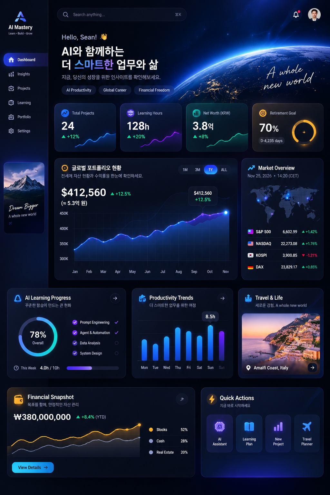

# Dashboard UI Redesign Concept

## 1. Design Direction
**Premium Intelligence Dashboard** — a modern, high-contrast dark dashboard with clear hierarchy, restrained glow effects, and data-led visual storytelling.

### Design goals
- Improve readability and scanability, especially for dense information.
- Establish a strong visual hierarchy: hero → KPIs → primary analytics → supporting modules → actions.
- Use accent colors consistently to communicate meaning rather than decoration.
- Keep the interface premium and contemporary without excessive gradients, borders, or effects.
- Preserve the existing information and features while improving their presentation.

## 2. Visual Concept
The design uses a deep navy background with subtle blue lighting, refined glass-like surfaces, and restrained accent colors. The hero area introduces the dashboard's identity, while the data sections remain the focus.

**Palette**
| Role | Color | Hex |
|---|---|---|
| Background | Deep navy | `#080D18` |
| Surface | Dark blue-gray | `#111A2B` |
| Primary | Blue | `#3478F6` |
| Accent | Cyan | `#20D6E8` |
| AI / Learning | Violet | `#9B6BFF` |
| Finance | Gold | `#F5B942` |
| Positive | Green | `#12C99A` |
| Negative | Coral | `#FF647C` |

## 3. Layout Structure

### A. Hero / Welcome
- Personal greeting and concise headline.
- One-line description of the dashboard's value.
- A small set of focus tags (e.g. AI Productivity, Global Career, Financial Freedom).
- Atmospheric background imagery/lighting kept subtle so text stays legible.

### B. KPI Cards
Four primary cards:
1. **Total Projects** — count, growth indicator, miniature trend line.
2. **Learning Hours** — total hours, growth indicator, trend line.
3. **Net Worth** — total value, YTD change, trend line.
4. **Retirement Goal** — progress percentage and circular progress visualization.

Each card should emphasize one primary number and limit secondary details.

### C. Portfolio Overview
- Main chart area with clear date-range controls.
- Portfolio value and percentage change prominently displayed.
- Simple, legible axes and limited gridlines.
- Market overview in a secondary panel alongside the main chart.

### D. Supporting Modules
- **AI Learning Progress:** overall progress, completed topics, weekly time target.
- **Productivity Trends:** weekly activity chart with a simple highlight.
- **Travel & Life:** editorial image card, destination label, and navigation affordance.

### E. Financial Snapshot & Quick Actions
- Financial snapshot: headline balance, change, simplified trend chart, asset mix.
- Quick actions: AI Assistant, Learning Plan, New Project, Travel Planner.
- Actions should be recognizable, easy to click, and not compete with the main data.

## 4. Typography & Hierarchy
Suggested starting scale (adjust to the actual font and responsive layout):
- Hero heading: 32–40 px
- Section heading: 20–24 px
- KPI number: 32–44 px
- Body: 14–16 px
- Caption / metadata: 12–13 px (avoid going smaller unless necessary)

Use a clean sans-serif typeface with strong numeric legibility. Keep heading weights distinct from body text.

## 5. Component Principles
- Use consistent card padding and corner radii.
- Prefer subtle borders over heavy shadows.
- Avoid applying the same card treatment to every section; vary layout based on content importance.
- Use color semantically and consistently: blue for primary, cyan for highlights, violet for AI/learning, gold for finance, green for positive, coral for negative.
- Charts should answer a specific question. Remove decorative chart elements that do not aid interpretation.
- Keep whitespace between modules to prevent visual fatigue.

## 6. Responsive Behavior
- Desktop: preserve the dashboard's multi-column layout and primary analytics prominence.
- Tablet: collapse secondary columns and keep KPI cards in a two-column grid.
- Mobile: stack modules vertically; prioritize hero, KPIs, portfolio, and quick actions. Make chart controls and touch targets comfortable to use.

## 7. Implementation Checklist
- [ ] Establish color tokens and typography scale.
- [ ] Build reusable card, KPI, chart, section-header, and quick-action components.
- [ ] Implement layout grid and responsive breakpoints.
- [ ] Improve chart contrast, labels, and spacing.
- [ ] Validate accessibility: contrast, focus states, keyboard navigation, and touch targets.
- [ ] Review at desktop, tablet, and mobile widths.
- [ ] Verify that existing metrics and features are preserved.

## 8. Design Mockup
The mockup is a visual direction reference, not a final production layout. Replace illustrative data and imagery with real content during implementation.

